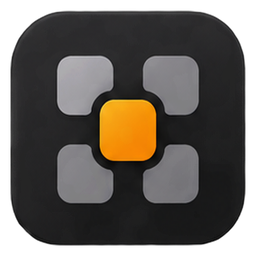

<div align="center">



# Too Many Terminals

**Every agent. Every shell. One window.**

All your Claude Code sessions in one place: see which ones are working, which are done
and which are waiting on you.

[**Download**](https://github.com/Exorsky/too-many-terminals/releases/latest) ·
[Features](#features) ·
[Docs](docs/)

</div>

https://github.com/user-attachments/assets/a6bcf677-890a-474a-8cd7-1411fa9ebd1d

## Why

Working with [Claude Code](https://claude.com/claude-code) usually means juggling a pile of
terminal windows: one per project, one per session, and no easy way to tell which one is
waiting on you. Too Many Terminals puts them all in one window. Claude sessions and your own
shells sit side by side, each with a live status, so you know where you're needed without
checking every tab.

Built with Tauri 2, so the builds are small native binaries (about 10–25 MB) for
Windows, macOS and Linux.

## Download

Get the latest build from [**Releases**](https://github.com/Exorsky/too-many-terminals/releases/latest).

| Platform | File |
|---|---|
| Windows (x64) | `Too.Many.Terminals_<version>_x64-setup.exe` |
| macOS (Apple silicon) | `Too.Many.Terminals_<version>_aarch64.dmg` |
| macOS (Intel) | `Too.Many.Terminals_<version>_x64.dmg` |
| Linux | `.AppImage` or `.deb` |

You need [Claude Code](https://claude.com/claude-code) installed for the Claude sessions.
Native shells work without it.

## Features

### Know who's waiting
- **Sessions with a live status.** Each session is a row with a status dot (idle, working,
  waiting on you) and its age. The list is grouped into Now, Today, Yesterday, This week and
  Earlier, with Inbox and Projects in the sidebar.
- **Desktop notifications** when an unfocused session finishes or needs your input.
- **Tabs name themselves** from your first message and show what Claude is doing right now.

### Claude and your shells, side by side
- **A tab is a session.** Split it right or down to open a native shell next to Claude:
  PowerShell or CMD on Windows, Zsh or Bash on macOS, Bash, Zsh or Fish on Linux.
- **Read a session like a document.** The transcript renders beside the live terminal and
  follows along as Claude answers. It has Markdown with mermaid diagrams, a find bar and
  copy buttons.

### Every path is clickable
- **Peek inside a file.** Hover any path in the terminal or the transcript to preview it as
  text, an image or a folder listing.
- **Jump to it.** Open the file in a tab or an app, show it in your file manager, or copy the
  path. A built-in file explorer and editor stay in step with what your sessions write.
- **Git at a glance.** Each session shows its branch and dirty state, and a Changes panel
  has diffs and a branch graph.

### Jira, built in
- **Issue keys are links everywhere.** A key like `PROJ-4821` links in session names and
  tabs, the title-bar breadcrumb, terminal output and transcripts. Hover it for a card with
  the status, assignee, priority, dates and the sessions that already mention it.
- **My issues.** Your open issues, grouped In progress and To do, with a marker when someone
  else wrote the latest comment.
- **Start a session from a ticket.** Its first prompt comes from a template you set per
  project key (`{key}`, `{summary}`, `{url}`). If a session for that ticket is already open,
  the app offers it instead.
- **Light on your Jira.** Read-only, no polling: one request when a card opens, cached for
  ten minutes, and it backs off when Jira rate-limits.
- **Setup:** Settings › Integrations › Jira. Add the server URL, your project keys and the
  name of the environment variable holding a personal access token. The app finds the token
  in its environment, the macOS Keychain item `claude-env` or `~/.claude/settings.json`, and
  never stores it. Works with Jira Server and Data Center; Jira Cloud isn't supported yet.

### Know your limits
- **Usage meter.** The official 5-hour and 7-day rate-limit windows sit in the title bar,
  with reset countdowns.
- **Token dashboard on Home.** Tokens, cache hit rate, consumption per project and daily
  activity, all built from your own session history. Click a session to open it.

### Find and resume any session
- **History.** Full-text search across past Claude Code sessions in every open folder.
  Resume any of them with one click.
- **Export or import a session** as a single file, or hand it to the Claude Code extension
  in VS Code mid-conversation.

### And more
- **To-Do** list that can hand work to Claude.
- **`.env` loading.** A folder's `.env` reaches the session at spawn, so secrets never get
  pasted into the conversation.
- **Auto-sleep.** An idle, off-screen session's process stops and resumes when you return.
- **Command palette.** `Ctrl+Shift+P` jumps to any open terminal.
- **Workspace persistence.** Your folders and tabs come back on the next launch.
- **Themes.** The Charcoal Orange default plus 15 popular presets (light ones included), a
  theme editor, and import from Windows Terminal, Ghostty, kitty or Alacritty.

## Development

```sh
pnpm install
pnpm tauri dev
```

Tests: `pnpm test` (frontend) · `pnpm test:rust` (backend).
Release build: `pnpm tauri build`.

Docs live in [docs/](docs/). Start with [architecture](docs/architecture.md); each feature
has its own page under [docs/features](docs/features/). Changes are listed in the
[changelog](CHANGELOG.md).
